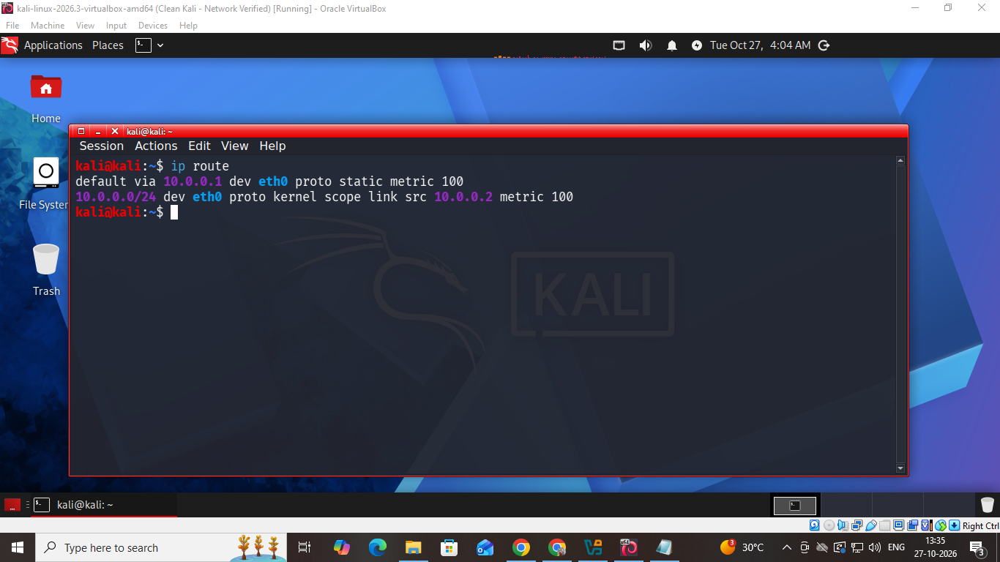
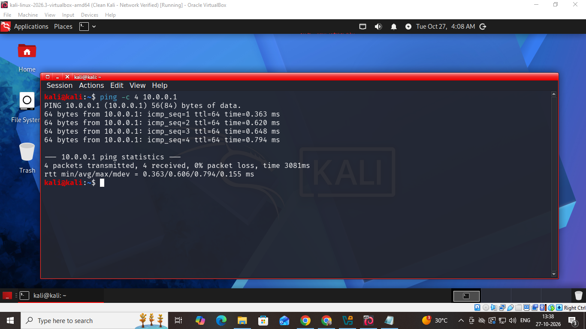
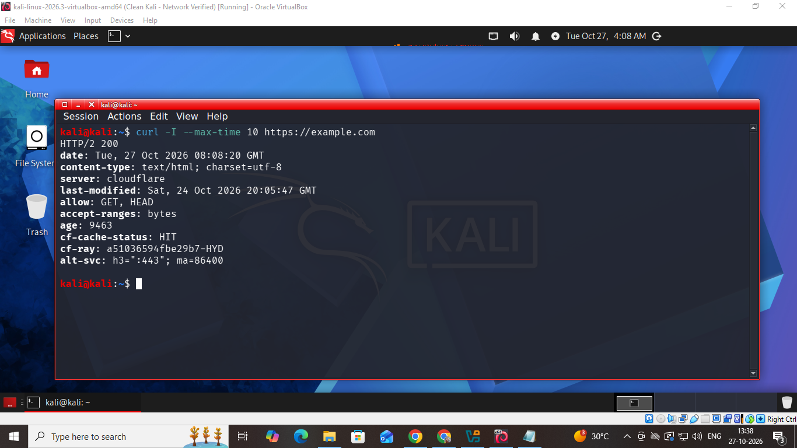
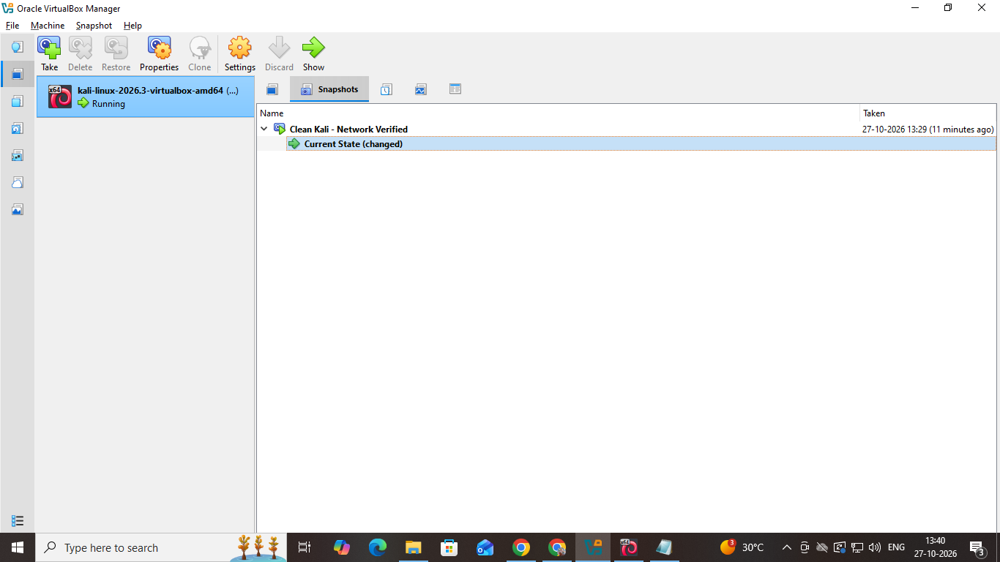
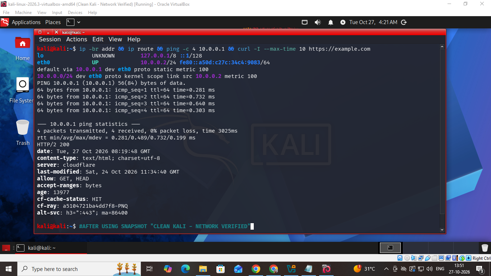

# WK1-PM1 — VirtualBox and Kali Linux Cybersecurity Lab Setup


**Project status: Completed — core lab setup, network validation, and post-snapshot connectivity checks succeeded.**

This repository documents the implementation of the **WK1-PM1 Week 1 / Project Module 1** lab task: build a VirtualBox-based Kali Linux environment for cybersecurity and ethical-hacking practice, configure a custom NAT Network, assign Kali the required static IPv4 address, and verify connectivity. The work also records two troubleshooting exercises encountered during setup.

## Overview

Oracle VirtualBox 7.2.22 (amd64) was installed on the Windows host after resolving an installer directory-permission problem. The Kali VM shown in VirtualBox is `kali-linux-2026.3-virtualbox-amd64`. The custom NAT Network is named `NatNetwork` and uses `10.0.0.0/24`. Kali's `eth0` interface was configured with the required static address `10.0.0.2/24` and default gateway `10.0.0.1`.

The final captured checks show four successful gateway ping replies, a successful HTTPS HEAD request to `https://example.com` (`HTTP/2 200`), successful DNS resolution for `example.com`, and Nmap 7.99 available in Kali. A VirtualBox snapshot named **`Clean Kali - Network Verified`** was created, and the key network checks were repeated after using the snapshot.

## Environment and addressing

| Component | Recorded configuration |
|---|---|
| Host | Windows; exact build not recorded in the supporting report |
| Hypervisor | Oracle VirtualBox 7.2.22 (amd64) |
| Guest VM | `kali-linux-2026.3-virtualbox-amd64` |
| Guest interface | `eth0` |
| Network attachment | NAT Network |
| NAT Network name | `NatNetwork` |
| Network CIDR | `10.0.0.0/24` |
| NAT gateway | `10.0.0.1` |
| Kali IPv4 | `10.0.0.2/24` — manual/static |
| DHCP server | `10.0.0.254` |
| DHCP lease range | `10.0.0.3`–`10.0.0.253` |
| DHCP | Enabled |
| NAT Network IPv6 | Disabled |

The DHCP server address and dynamic lease range were adjusted so the reserved Kali address, `10.0.0.2`, was outside the dynamic range.

```text
Windows host
    |
    +-- Oracle VirtualBox
          |
          +-- NatNetwork: 10.0.0.0/24
                |-- Gateway: 10.0.0.1
                |-- Kali Linux eth0: 10.0.0.2/24 (static)
                +-- DHCP server: 10.0.0.254
                    Dynamic range: 10.0.0.3 - 10.0.0.253
```

## Troubleshooting and resolution

### VirtualBox installer rejected the installation directory

The VirtualBox 7.2.22 installer initially displayed **“Invalid installation directory”** for `G:\VBox`. Inspecting the directory ACL with `icacls` showed inherited **Modify** permissions for `NT AUTHORITY\Authenticated Users`. Inheritance was disabled on the installation directory while inherited permissions were copied, and that principal's entry was removed from the directory ACL. The ACL was checked again, after which VirtualBox installed successfully. Later `VBoxManage` commands were used successfully during lab network configuration, providing additional evidence that the installation was operational.

The permission entry is documented as the likely cause based on the recorded before-and-after ACL output and successful installation, rather than as an installer diagnosis: the installer message itself did not identify the specific ACL entry. The permission commands were run without `/T`; the report does not claim the ACL change was recursively applied to every child path. See [the detailed installer troubleshooting report](docs/virtualbox-installation-troubleshooting.md).

### Static IP and DHCP address-allocation conflict

During network setup, Kali initially received `10.0.0.3/24` over DHCP. When the required static address was activated, NetworkManager reported that `10.0.0.2` was already in use. The initial VirtualBox DHCP configuration used `10.0.0.2` as the DHCP server address and had a lease range extending through `10.0.0.254`.

The VirtualBox DHCP server was changed to `10.0.0.254`, and the lease range was narrowed to `10.0.0.3`–`10.0.0.253`. Kali was restarted, and `eth0` was then shown active at `10.0.0.2/24` with the default route through `10.0.0.1`. The exact owner of the address seen in the duplicate-address warning was not independently identified, so this report does not assign it to a particular device. See [the detailed network troubleshooting and recovery report](docs/kali-linux-network-troubleshooting-and-recovery.md).

## Verification results

| Check | Command | Recorded result |
|---|---|---|
| Interface/address | `ip -br addr` | `eth0` UP at `10.0.0.2/24` |
| Route table | `ip route` | Default route via `10.0.0.1`; connected route for `10.0.0.0/24` |
| NetworkManager profile | `nmcli connection show "Wired connection 1"` with selected IPv4 fields | Manual addressing, `10.0.0.2/24`, gateway `10.0.0.1` |
| Gateway reachability | `ping -c 4 10.0.0.1` | 4 transmitted, 4 received, 0% packet loss |
| External HTTPS | `curl -I --max-time 10 https://example.com` | `HTTP/2 200` |
| DNS | `getent ahostsv4 example.com` | IPv4 address records returned for `example.com` |
| Nmap executable | `nmap --version` | Nmap 7.99 |
| Snapshot | VirtualBox Manager | `Clean Kali - Network Verified` created on 27 October 2026 |
| Post-snapshot check | Repeated interface, route, ping, and HTTPS checks | Required IP/route remained present; gateway ping and HTTPS succeeded |

The Nmap check establishes that the tool is installed and executable; **no port scan is claimed in this task**. DNS was tested directly because the final captured NetworkManager profile showed no per-connection DNS value.

### Selected evidence

**Kali address and routing table**




**Gateway and Internet verification**





**Snapshot and post-snapshot validation**





Timestamp note: The Windows host and Kali Linux guest displayed different clock values during evidence capture. The screenshots are retained as captured records. Network verification is based on the recorded interface configuration, routing table, gateway ping results, DNS lookup, and external HTTPS response—not on matching host and guest timestamps. The clock discrepancy was not independently diagnosed as part of this task.

## Evidence index

All 17 supplied screenshots are included in `evidence/`, with descriptive, repository-safe filenames. Select any filename to inspect the full image.

| # | Evidence file | What it documents |
|---:|---|---|
| 01 | [`01-virtualbox-installer-directory-error.png`](evidence/01-virtualbox-installer-directory-error.png) | Initial VirtualBox installer error; the supporting report documents the correction and successful installation |
| 02 | [`02-virtualbox-manager-initial-launch.png`](evidence/02-virtualbox-manager-initial-launch.png) | VirtualBox Manager start screen |
| 03 | [`03-kali-vm-overview-initial.png`](evidence/03-kali-vm-overview-initial.png) | Kali VM overview in VirtualBox Manager |
| 04 | [`04-natnetwork-configuration.png`](evidence/04-natnetwork-configuration.png) | `NatNetwork` with IPv4 prefix `10.0.0.0/24` and DHCP enabled |
| 05 | [`05-kali-vm-overview.png`](evidence/05-kali-vm-overview.png) | Kali VM overview after configuration changes |
| 06 | [`06-kali-vm-network-adapter-settings.png`](evidence/06-kali-vm-network-adapter-settings.png) | VM network adapter attached to `NatNetwork` |
| 07 | [`07-kali-desktop.png`](evidence/07-kali-desktop.png) | Kali desktop running in VirtualBox |
| 08 | [`08-kali-ip-address.png`](evidence/08-kali-ip-address.png) | `eth0` active at `10.0.0.2/24` |
| 09 | [`09-kali-routing-table.png`](evidence/09-kali-routing-table.png) | Default and connected routes |
| 10 | [`10-networkmanager-profile.png`](evidence/10-networkmanager-profile.png) | NetworkManager manual IPv4 profile and gateway |
| 11 | [`11-gateway-ping-test.png`](evidence/11-gateway-ping-test.png) | Gateway ping: 4/4 replies, 0% packet loss |
| 12 | [`12-external-https-test.png`](evidence/12-external-https-test.png) | HTTPS request to `example.com`: `HTTP/2 200` |
| 13 | [`13-dns-resolution-test.png`](evidence/13-dns-resolution-test.png) | DNS lookup results for `example.com` |
| 14 | [`14-nmap-version.png`](evidence/14-nmap-version.png) | Nmap 7.99 version output |
| 15 | [`15-virtualbox-snapshot-created.png`](evidence/15-virtualbox-snapshot-created.png) | Snapshot named `Clean Kali - Network Verified` |
| 16 | [`16-kali-desktop-after-snapshot.png`](evidence/16-kali-desktop-after-snapshot.png) | Kali desktop following the snapshot step |
| 17 | [`17-post-snapshot-recovery-test.png`](evidence/17-post-snapshot-recovery-test.png) | Post-snapshot/recovery checks for IP, route, gateway, and HTTPS |

## Repository structure

```text
WK1-PM1-Kali-Lab-Setup/
├── README.md
├── .gitignore
├── docs/
│   ├── task-scope.md
│   ├── virtualbox-installation-troubleshooting.md
│   └── kali-linux-network-troubleshooting-and-recovery.md
└── evidence/
    ├── 01-virtualbox-installer-directory-error.png
    ├── 02-virtualbox-manager-initial-launch.png
    ├── 03-kali-vm-overview-initial.png
    ├── 04-natnetwork-configuration.png
    ├── 05-kali-vm-overview.png
    ├── 06-kali-vm-network-adapter-settings.png
    ├── 07-kali-desktop.png
    ├── 08-kali-ip-address.png
    ├── 09-kali-routing-table.png
    ├── 10-networkmanager-profile.png
    ├── 11-gateway-ping-test.png
    ├── 12-external-https-test.png
    ├── 13-dns-resolution-test.png
    ├── 14-nmap-version.png
    ├── 15-virtualbox-snapshot-created.png
    ├── 16-kali-desktop-after-snapshot.png
    └── 17-post-snapshot-recovery-test.png
```

The original WK1-PM1 training PDF was used as the task reference but is not copied into this public-facing package. The relevant scope is summarized in [`docs/task-scope.md`](docs/task-scope.md). The supplied screenshots document the network and recovery work; they do not visibly show the dedicated Shared Clipboard/Drag'n'Drop controls or the host `/downloads` shared-folder configuration, so this report does not claim separate screenshot-based verification of those particular UI settings.

## Reproduction outline

Create the custom `NatNetwork` on `10.0.0.0/24` with gateway `10.0.0.1`. Keep Kali's required static IP, `10.0.0.2/24`, outside the DHCP lease range; in this setup the DHCP server is `10.0.0.254` and its range is `10.0.0.3`–`10.0.0.253`. Attach the Kali VM to that NAT Network, activate the manual IPv4 profile, and then run the interface, route, gateway, HTTPS, DNS, and tool-version checks shown above. After verifying the base environment, create a clearly named VM snapshot and repeat the key connectivity checks after using it.


## What this demonstrates

Address configuration used a manual IPv4 profile on Kali's `eth0` interface. 
The assigned guest address was `10.0.0.2/24` within `10.0.0.0/24`. 
Host-side VirtualBox settings provided the NAT gateway at `10.0.0.1`. 
A DHCP server at `10.0.0.254` distributed addresses only from `10.0.0.3` through `10.0.0.253`. 
Route inspection confirmed the default route through `10.0.0.1`.
Verification included four successful ICMP replies from the gateway. 
Access to an external HTTPS endpoint was checked with `curl` and returned `HTTP/2 200`. 

DNS resolution for `example.com` was checked separately with `getent ahostsv4`. 
Evidence screenshots document the interface, routing, DNS, HTTPS, and snapshot checks. 
Snapshot `Clean Kali - Network Verified` was created before the post-snapshot validation.
Host and guest clocks displayed different values during evidence capture, so timestamps were not treated as network-validation results. 
Post-snapshot checks repeated the interface, route, gateway, and HTTPS tests. 
Although Nmap 7.99 was available, no port scan was performed as part of this task. 
No broader security testing is claimed beyond the recorded checks. 
DHCP pool adjustment kept the statically assigned Kali address outside the dynamic range. 
Exact ownership of the duplicate-address warning was not independently established.


<!--
PROJECT PROVENANCE
Original Author: Atharva Deshpande
Project Reference: AD-WK1-PM1-2026
Original Repository: Atharva-Deshpande6388
-->
