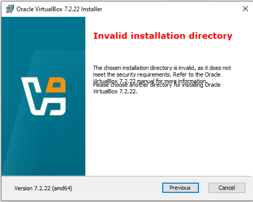

# Troubleshooting Oracle VirtualBox 7.2.22: “Invalid installation directory”

**Status: Resolved — VirtualBox installed successfully after correcting the directory permissions.**

## Summary

During installation of Oracle VirtualBox 7.2.22 (amd64) on Windows, the installer rejected the selected installation directory, `G:\VBox`, with the message **“Invalid installation directory.”** The installer stated that the chosen directory did not meet its security requirements.

Inspecting the directory's access-control list (ACL) revealed that `NT AUTHORITY\Authenticated Users` had **Modify** permission. We disabled inheritance on the installation directory, removed that principal's ACL entry, and verified the resulting permissions. The VirtualBox installation then completed successfully. Subsequent lab work used `G:\VBox\VBoxManage` to inspect and modify the NAT Network and DHCP configuration, confirming that the installation was operational.

The permissions entry was the likely cause based on the before-and-after ACL output and the successful installation after the change. The installer did not identify the specific ACL entry itself.

## Environment

- **Operating system:** Windows (version/build not recorded in this troubleshooting entry)
- **Application:** Oracle VirtualBox 7.2.22 (amd64)
- **Installation directory:** `G:\VBox`
- **Status:** Resolved

## 1. Symptom

The installer displayed:

> **Invalid installation directory**  
> The chosen installation directory is invalid, as it does not meet the security requirements. Refer to the Oracle VirtualBox 7.2.22 manual for more information.

The installer message did not name a particular permission or ACL entry, so the directory's permissions were inspected.

## 2. Inspect the initial permissions

Command run from an elevated Windows Command Prompt:

```cmd
icacls G:\VBox
```

Recorded initial output:

```text
G:\VBox BUILTIN\Administrators:(I)(F)
        BUILTIN\Administrators:(I)(OI)(CI)(IO)(F)
        NT AUTHORITY\SYSTEM:(I)(F)
        NT AUTHORITY\SYSTEM:(I)(OI)(CI)(IO)(F)
        NT AUTHORITY\Authenticated Users:(I)(M)
        NT AUTHORITY\Authenticated Users:(I)(OI)(CI)(IO)(M)
        BUILTIN\Users:(I)(RX)
        BUILTIN\Users:(I)(OI)(CI)(IO)(GR,GE)

Successfully processed 1 files; Failed processing 0 files
```

The entries that stood out were:

```text
NT AUTHORITY\Authenticated Users:(I)(M)
NT AUTHORITY\Authenticated Users:(I)(OI)(CI)(IO)(M)
```

`(M)` means **Modify** and `(I)` means the permission was inherited. The output showed that `Authenticated Users` had inherited Modify access on the directory ACL. This was treated as the likely reason the directory failed the installer's security check.

## 3. Correct the directory ACL

The following commands were run against the installation directory:

```cmd
icacls "G:\VBox" /inheritance:d
icacls "G:\VBox" /remove "NT AUTHORITY\Authenticated Users"
```

- `/inheritance:d` disables inheritance on the specified directory while copying inherited permissions into explicit entries.
- `/remove` removes the named principal's permissions from that directory's ACL.

The commands were intentionally run **without `/T`**, so they did not recursively modify every file and subdirectory under `G:\VBox`.

## 4. Verify the updated permissions

The ACL was queried again:

```cmd
icacls "G:\VBox"
```

Recorded output after the change:

```text
G:\VBox BUILTIN\Administrators:(F)
        BUILTIN\Administrators:(OI)(CI)(IO)(F)
        NT AUTHORITY\SYSTEM:(F)
        NT AUTHORITY\SYSTEM:(OI)(CI)(IO)(F)
        BUILTIN\Users:(RX)
        BUILTIN\Users:(OI)(CI)(IO)(GR,GE)

Successfully processed 1 files; Failed processing 0 files
```

The updated output showed:

- `BUILTIN\Administrators`: Full Control (`F`)
- `NT AUTHORITY\SYSTEM`: Full Control (`F`)
- `BUILTIN\Users`: Read & Execute (`RX`)
- No `NT AUTHORITY\Authenticated Users` entry in the displayed ACL for `G:\VBox`

This verifies the ACL displayed for `G:\VBox` itself. Since the commands were not recursive, this output does not claim that all existing child files and directories have identical permissions.

## 5. Installation result and post-install verification

After the ACL correction, **the VirtualBox installation succeeded**. VirtualBox was then used for the cybersecurity lab setup through its command-line tools located in `G:\VBox`.

Examples of subsequent commands used successfully:

```cmd
G:\VBox\VBoxManage list dhcpservers
G:\VBox\VBoxManage list natnets
G:\VBox\VBoxManage dhcpserver modify --network=NatNetwork --server-ip=10.0.0.254 --lower-ip=10.0.0.3 --upper-ip=10.0.0.253
```

These later operations confirm that the installed VirtualBox command-line tools were available and operational. The DHCP command was used in the separate lab-network configuration step; it is included here as post-installation evidence, not as part of the ACL repair.

| Check | Outcome |
|---|---|
| Installer rejected `G:\VBox` | Confirmed by screenshot |
| Initial ACL included inherited `Authenticated Users: Modify` entries | Confirmed by recorded `icacls` output |
| ACL correction commands executed | Recorded in the troubleshooting exchange |
| Updated ACL no longer displayed `Authenticated Users` on `G:\VBox` | Confirmed by subsequent `icacls` output |
| VirtualBox installation completed successfully after the change | Confirmed |
| VirtualBox CLI usable for subsequent lab configuration | Confirmed by later `VBoxManage` commands |

## Lessons learned
<!--
1. Inspect the directory ACL before changing permissions.
2. Use the actual `icacls` output to identify potentially over-permissive entries instead of changing permissions blindly.
3. Scope permission changes narrowly, and do not add `/T` unless recursive changes are specifically needed and understood.
4. Verify both the permission change and the application outcome. Here, the updated ACL was followed by a successful installation and subsequent use of `VBoxManage`.
-->
At first, the VirtualBox installer rejected `G:\VBox` with an installation-directory security error. The message did not identify the exact permission entry responsible. Host-side `icacls G:\VBox` output showed inherited permissions for `NT AUTHORITY\Authenticated Users`. ACL inspection showed that this principal had inherited Modify permissions on the displayed installation directory. Review of the before-and-after evidence treated that entry as the likely cause rather than a confirmed installer diagnosis.

Verification after the ACL changes showed no `Authenticated Users` entry in the displayed directory ACL. Administrators and SYSTEM retained Full Control, while Users retained Read & Execute permissions. Disabling inheritance with `/inheritance:d` copied inherited permissions into explicit entries on `G:\VBox`. Existing child files and subdirectories were not recursively modified because `/T` was not used. Subsequent VirtualBox installation completed successfully after the permission correction.

Host-side use of `G:\VBox\VBoxManage` confirmed that the command-line tools were available for subsequent lab configuration. Post-installation commands successfully inspected and modified the NAT Network and DHCP settings. Although this confirms that the installation was operational, it does not establish identical permissions across every child path. No recursive ACL verification is claimed. Directory permissions should be inspected before making changes, and modifications should be scoped narrowly. Evidence and subsequent VirtualBox usage together support the successful installation.


## Evidence included in this repository

The initial installer error is shown in . The installer dialog image is cropped to remove unrelated browser/account UI while retaining the error message and version. The before-and-after ACL output is recorded in this report; separate ACL terminal screenshots were not included in the supplied evidence set. Successful installation is further supported by subsequent use of `G:\VBox\VBoxManage` during lab network configuration and by the VirtualBox Manager/Kali VM captures in the evidence folder.

<!--
PROJECT PROVENANCE
Original Author: Atharva Deshpande
Project Reference: AD-WK1-PM1-2026
Original Repository: Atharva-Deshpande6388
-->
